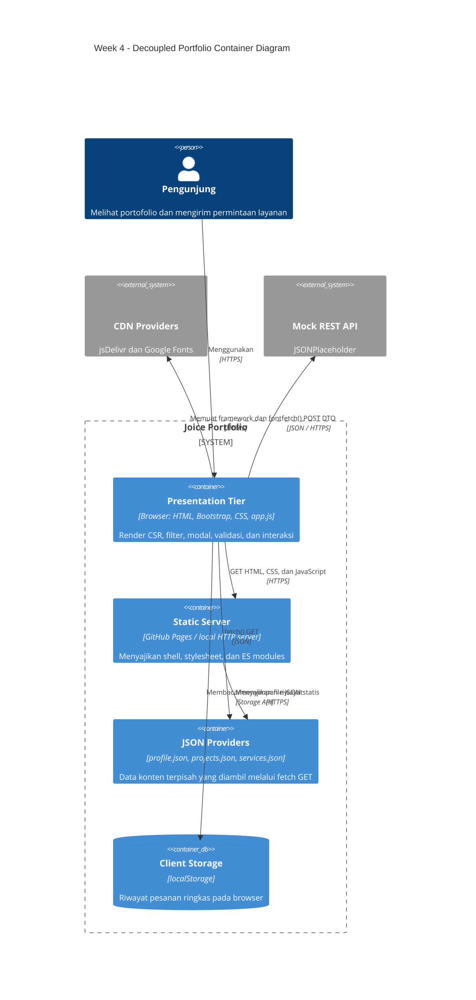

# Joice Portfolio | Week 4

Portofolio satu halaman Joice Anastasya Napitupulu yang direfactor dari Week 3 menjadi aplikasi statis decoupled. Halaman menampilkan hero dengan kartu profil dan foto, portofolio proyek, skills, paket layanan, riwayat, serta form. Konten proyek dan layanan dimuat dari JSON menggunakan JavaScript ES modules.

## Identitas

| Atribut | Nilai |
| --- | --- |
| Nama | Joice Anastasya Napitupulu |
| NIM | 12S24020 |
| Kelas | 13SI1 |
| Program studi | Sarjana Sistem Informasi, Institut Teknologi Del |

## Fitur Week 4

- CSR menggunakan `fetch()` dan `async/await` dengan JSON provider terpisah.
- Kartu profil di hero menampilkan foto lokal `foto.saya.jpeg`, nama, program studi, institusi, email, dan GitHub.
- Loading, success, empty, dan error states untuk konten dinamis.
- Filter proyek berdasarkan kategori.
- Satu Bootstrap modal universal yang dirender berdasarkan project ID.
- Form layanan mengirim DTO JSON secara asynchronous, menampilkan Bootstrap Toast, dan menyimpan riwayat ringkas di `localStorage`.
- Paket layanan menampilkan harga fleksibel yang menyesuaikan ruang lingkup proyek, bukan nominal tetap.
- Tampilan memakai hero responsif, kartu rounded, dan tipografi Manrope/Roboto Condensed/Caveat.
- CSP membatasi sumber script, stylesheet, font, gambar, dan koneksi API.
- Semua nilai dari JSON dan form ditampilkan melalui DOM API serta `textContent`, bukan `innerHTML`.

## Teknologi

- HTML5 semantik, Bootstrap 5.3, Bootstrap Icons, dan custom CSS.
- JavaScript ES modules (`app.js` dan `api-service.js`).
- JSON sebagai data provider statis.
- GitHub Pages sebagai static host; JSONPlaceholder sebagai mock REST endpoint.

## Menjalankan Secara Lokal

Jangan membuka `index.html` langsung dengan skema `file://`, karena browser membatasi `fetch()` untuk JSON lokal. Jalankan static server dari root proyek:

```powershell
python -m http.server 5500
```

Buka `http://localhost:5500/`. Alternatifnya, gunakan VS Code Live Server.

## Struktur Proyek

```text
.
├── data/
│   ├── profile.json
│   ├── projects.json
│   └── services.json
├── js/
│   ├── api-service.js
│   └── app.js
├── foto.saya.jpeg
├── index.html
├── style.css
└── README.md
```

- `index.html`: semantic shell, target render, satu universal modal, dan form.
- `data/profile.json`: biodata, foto, skills, serta sampel performa reload lokal.
- `data/projects.json`: empat proyek lengkap dengan kategori, tags, metrics, gambar, dan tautan.
- `data/services.json`: tiga paket layanan, fitur, dan keterangan harga fleksibel.
- `js/api-service.js`: data access layer untuk GET JSON dan mock POST.
- `js/app.js`: presentation layer, UI states, filter, modal, validasi, toast, dan local state.
- `style.css`: tema visual, layout responsif, dan custom Bootstrap overrides.
- `foto.saya.jpeg`: foto lokal untuk kartu profil pada hero.

## Arsitektur C4 Container



### Pemisahan Tanggung Jawab

Presentation tier berada pada browser: `index.html`, Bootstrap, `style.css`, dan `js/app.js` mengelola rendering serta interaksi. `js/api-service.js` menjadi batas akses application/service: ia mengambil JSON dan mengirim DTO ke mock REST API. JSON statis dan `localStorage` adalah lapisan data yang terpisah; GitHub Pages hanya menyajikan file statis, bukan menjalankan backend.

### Perbandingan Sebelum dan Sesudah

| Aspek | Sebelum (Week 3) | Sesudah (Week 4) |
| --- | --- | --- |
| Data proyek dan modal | Kartu serta modal hardcoded di HTML | Proyek dari `projects.json`; satu modal dirender berdasarkan ID |
| Profil dan layanan | Teks/opsi ditulis di markup | `profile.json` dan `services.json` dimuat dengan `fetch()` |
| Rendering | HTML statis | Client-Side Rendering setelah response JSON diterima |
| Form layanan | Validasi browser, belum ada dispatch API | `fetch()` POST JSON ke mock API, toast, tanpa full reload |
| Riwayat pesanan | Tidak disimpan | Riwayat ringkas di `localStorage` dan badge jumlah pesanan |
| Error jaringan | Tidak ada state data provider | Loading, success, empty, dan error fallback ditangani |

### Trade-off Arsitektur

| Paradigma | Tempat render | Kelebihan | Trade-off |
| --- | --- | --- | --- |
| Monolith SSR | Server merakit HTML dan data per request | HTML awal lengkap dan aturan bisnis terpusat | Membutuhkan server runtime; UI yang sering berubah dapat menambah beban server |
| Decoupled CSR | Browser merakit UI dari JSON setelah shell dimuat | Interaksi dan filter terasa responsif; frontend dan data dipisahkan | Konten bergantung pada JavaScript dan fetch; error/loading harus ditangani di client |
| Jamstack | Aset statis disajikan CDN, data/API dipanggil terpisah | Hosting sederhana dan distribusi aset cepat | Operasi dinamis tetap memerlukan layanan API eksternal |
| Microservices | Aturan bisnis dipisah ke layanan independen | Tiap layanan dapat dikembangkan dan diskalakan terpisah | Lebih banyak komponen jaringan, observability, dan operasional daripada proyek ini perlukan |

Proyek ini menggunakan static hosting/Jamstack dengan rendering CSR di browser. JSON lokal adalah mock data provider, sedangkan endpoint POST publik hanya simulasi; ini belum menjadi sistem microservices atau backend bisnis produksi.

### Batasan Mock API dan Privasi

Pengiriman form menggunakan `https://jsonplaceholder.typicode.com/posts` untuk demonstrasi kontrak POST. Layanan ini tidak memproses pesanan sungguhan dan bukan backend produksi. Jangan memasukkan data pribadi nyata; sebelum deployment layanan sesungguhnya, ganti endpoint dengan backend tepercaya dan tinjau kebijakan privasi. `localStorage` hanya menyimpan nama, pilihan layanan, ID response mock, dan waktu pengiriman pada browser yang sedang digunakan.

## Profil Kinerja Jaringan

`data/profile.json` saat ini mencatat sampel lokal saat reload pada 4 Oktober 2026: TTFB 1 ms dan FCP 112 ms. Nilai itu bukan cold/warm load GitHub Pages. Tabel berikut sengaja belum diisi sampai pengukuran aktual dilakukan di DevTools pada live deployment; hasil dapat berbeda menurut lokasi, koneksi, dan cache.

| Ukuran | Cold Load | Warm Load | Cara mencatat |
| --- | --- | --- | --- |
| TTFB dokumen utama | Belum diukur | Belum diukur | Network → pilih request `document` → Timing / Waiting for server response |
| First Contentful Paint | Belum diukur | Belum diukur | Performance atau Lighthouse → FCP |
| Ukuran transfer total | Belum diukur | Belum diukur | Network footer → transferred |
| Status cache dokumen/CSS/JS/JSON | Belum diukur | Belum diukur | Catat status, `Cache-Control`, `ETag`, dan `Size` |
| `304 Not Modified` | Belum diukur | Belum diukur | Bandingkan request saat cache aktif; 304 hanya dicatat bila benar-benar terlihat |

### Prosedur Cold vs Warm Load

1. Buka live deployment, buka DevTools → Network, centang **Disable cache**, lalu lakukan hard reload untuk cold load.
2. Catat TTFB, FCP, status dan ukuran transfer request HTML, CSS, JavaScript, JSON, serta request font/image. Simpan screenshot waterfall sebagai `docs/screenshots/network-cold.png`.
3. Uncheck **Disable cache**, reload halaman yang sama, dan catat hasil warm load beserta header `Cache-Control` dan `ETag`.
4. Simpan screenshot waterfall warm load sebagai `docs/screenshots/network-warm.png`. Jika server mengirim `304`, catat request dan header yang terkait; jangan mengasumsikan status tersebut pasti muncul.
5. Ganti nilai “Belum diukur” di tabel di atas dan lampirkan kedua screenshot sebelum pengumpulan.

Live deployment: [GitHub Pages](https://joicenapitupulu.github.io/ppw-2026-week2-12S24020/)

## CSP dan Keamanan DOM

Kebijakan Content Security Policy berada di meta tag `index.html`. Sumber script dibatasi ke origin sendiri dan jsDelivr; koneksi data hanya ke origin sendiri dan JSONPlaceholder; `object-src 'none'` serta `base-uri 'self'` mengurangi permukaan serangan. Kebijakan ini adalah defense-in-depth, bukan pengganti validasi backend.

Data eksternal dirender menggunakan `createElement`, `textContent`, dan atribut yang divalidasi. URL gambar/tautan dibatasi ke protokol HTTP(S). Dengan demikian, string deskripsi atau input pengguna tidak diparse sebagai markup HTML.

## Verifikasi Lokal

```powershell
Get-Content -Raw .\data\profile.json | ConvertFrom-Json
Get-Content -Raw .\data\projects.json | ConvertFrom-Json
Get-Content -Raw .\data\services.json | ConvertFrom-Json
```

Uji browser melalui HTTP server dan Console/Network DevTools. Pastikan empat proyek tampil, filter kategori bekerja, semua tombol membuka modal tunggal, form tidak me-reload halaman, dan badge berubah setelah mock API menerima POST.

## Kontribusi

Kontribusi sangat terbuka untuk pengembangan project ini. Jika Anda ingin berkontribusi, silakan lakukan langkah berikut:

1. Fork repository ini
2. Buat branch baru:

```bash
git checkout -b feature/nama-fitur
```

3. Commit perubahan:

```bash
git commit -m "Add: fitur baru"
```

4. Push ke branch Anda:

```bash
git push origin feature/nama-fitur
```

5. Buat Pull Request untuk review

## Lisensi

MIT License

Copyright (c) 2026 Joice Anastasya Napitupulu

Permission is hereby granted, free of charge, to any person obtaining a copy
of this software and associated documentation files (the "Software"), to deal
in the Software without restriction, including without limitation the rights
to use, copy, modify, merge, publish, distribute, sublicense, and/or sell
copies of the Software, and to permit persons to whom the Software is
furnished to do so, subject to the following conditions:

The above copyright notice and this permission notice shall be included in all
copies or substantial portions of the Software.

THE SOFTWARE IS PROVIDED "AS IS", WITHOUT WARRANTY OF ANY KIND, EXPRESS OR
IMPLIED, INCLUDING BUT NOT LIMITED TO THE WARRANTIES OF MERCHANTABILITY,
FITNESS FOR A PARTICULAR PURPOSE AND NONINFRINGEMENT. IN NO EVENT SHALL THE
AUTHORS OR COPYRIGHT HOLDERS BE LIABLE FOR ANY CLAIM, DAMAGES OR OTHER
LIABILITY, WHETHER IN AN ACTION OF CONTRACT, TORT OR OTHERWISE, ARISING FROM,
OUT OF OR IN CONNECTION WITH THE SOFTWARE OR THE USE OR OTHER DEALINGS IN THE
SOFTWARE.
